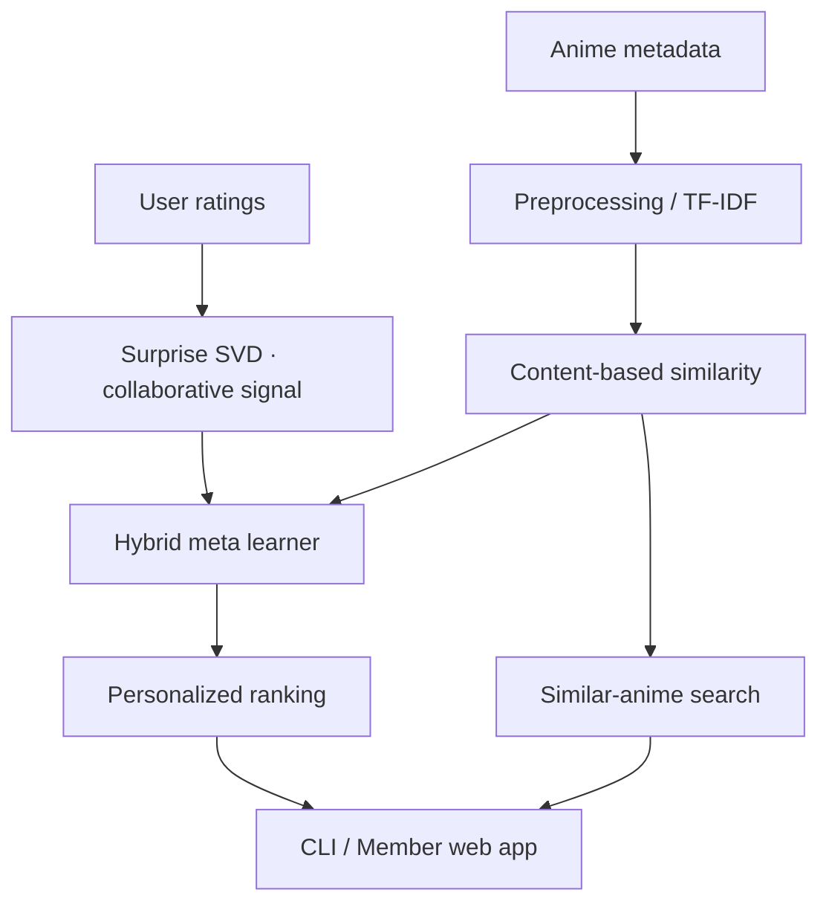

<div align="center">

# 🍥 Anime Recommendation System

### A Hybrid Recommendation Engine with Personalized Ranking

**Discover anime beyond the obvious.**  
협업 필터링·콘텐츠 특징·메타러너를 결합한 애니메이션 추천 시스템


[Features](#features) · [Architecture](#recommendation-architecture) · [Quick Start](#quick-start) · [Project Structure](#project-structure)

</div>

---

## Overview

유저가 좋아하는 작품을 찾는 데는 **비슷한 사용자의 취향**과 **작품 자체의 특성**이 모두 중요합니다. 이 프로젝트는 세 가지 정보를 결합해 개인화 추천과 유사 작품 탐색을 구현합니다.

| Signal | How it is used |
|:--|:--|
| **Collaborative filtering** | Surprise SVD로 유저–작품 평점 패턴 학습 |
| **Content similarity** | 장르·제작사·작품 유형 등 메타데이터 기반 특징 |
| **Meta learning** | LightGBM, XGBoost, CatBoost 후보로 협업·콘텐츠 신호를 결합 |

## Screenshots

<table>
<tr>
<td></td>
<td></td>
</tr>
</table>

## Features

- **Content-based discovery:** 작품명을 검색한 뒤 비슷한 장르·제작 특성을 가진 애니메이션 탐색
- **Personalized recommendation:** 사용자 평점과 SVD 기반 협업 신호를 혼합
- **Cold-start handling:** 새 회원은 평점을 입력하면 full SVD 재학습 없이 사용자 벡터를 보정하는 fold-in 경로 사용
- **Member web app:** 회원가입, 애니메이션 검색·평점 부여, 평점 10개 이후 개인화 추천
- **Visualization:** t-SNE 기반 3D 애니메이션 임베딩 탐색 화면
- **Memory-conscious inference:** 학습·추론용 대용량 모델을 분리하고 경량 추론 파일로 변환

## Recommendation Architecture



**설계 포인트:** 유사 작품 탐색은 경량 콘텐츠 기반 경로로 제공하고, 개인화 추천은 사용자 평점과 Hybrid 모델을 사용합니다. 큰 SVD·유사도 산출물은 서버 메모리 사용을 줄이기 위해 별도 경량 포맷으로 최적화합니다.

## Quick Start

**Requirements:** Python, Git LFS, 프로젝트 데이터. 협업 필터링·Hybrid 추론을 위한 학습 모델은 저장소에 포함되지 않을 수 있습니다.

```bash
git clone https://github.com/Ai-pre/Anime-recommendation-system.git
cd Anime-recommendation-system
git lfs install
git lfs pull
python -m pip install -r requirements.txt

# Validate paths & data
python main.py check

# Lightweight content similarity
python main.py similar --title "Naruto" --top-n 10
```

전체 Hybrid 추천은 로컬에 다음 모델이 있어야 합니다.

```text
models/svd_model.pkl
models/meta_model.pkl
```

```bash
# Recommend for an existing user (after preparing model artifacts)
python main.py recommend-user --user-id 116169 --top-n 10

# Optional: optimize artifacts for memory
python main.py optimize-models

# Web UIs
python app.py --host 127.0.0.1 --port 8000
python member_app.py --host 127.0.0.1 --port 8100
```

**Model availability:** 대용량 학습 모델은 GitHub에 포함하지 않았으므로 개인화 추천은 해당 파일을 준비하거나 직접 학습해야 합니다. 모델 없이도 가능한 기능 범위는 다릅니다. 상세 실행 방법은 [원본 문서](docs/README_BEFORE_PORTFOLIO_REFRESH.md)를 참고하세요.

## Project Structure

| Folder / file | Role |
|:--|:--|
| [`anime_recommender/training.py`](anime_recommender/training.py) | SVD / hybrid 모델 학습 |
| [`anime_recommender/content_similarity.py`](anime_recommender/content_similarity.py) | 콘텐츠 유사도 계산 |
| [`anime_recommender/inference.py`](anime_recommender/inference.py) | 추천 추론 |
| [`anime_recommender/svd_light.py`](anime_recommender/svd_light.py) | 경량 SVD 추론 경로 |
| [`anime_recommender/member_web.py`](anime_recommender/member_web.py) | 회원 서비스 |
| [`anime_recommender/visualization.py`](anime_recommender/visualization.py) | 3D 시각화 |
| [`data/`](data/) | 학습·입력 데이터 (대용량 일부 Git LFS) |

## Limitations

- 공개 README에서 **외부 데이터셋에 대한 성능·정확도를 검증한 수치**를 주장하지 않습니다.
- 일부 평점 CSV와 모델 파일은 용량이 크며, 모델 재현에는 충분한 메모리·학습 시간이 필요합니다.
- 협업 필터링은 평점 이력이 적은 신규 사용자에 약하므로 fold-in·콘텐츠 기반 경로로 보완합니다.

---

<div align="center">

**Collaborative signals × content understanding × personalized ranking**

[Portfolio ↗](https://ai-pre.github.io/Ai-pre/) · [Project notes ↗](https://app.notion.com/p/35706d3e452480fda072de810598799f)

</div>